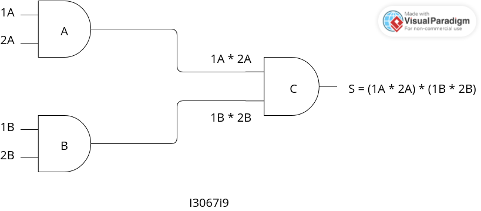

# portas-logicas-and
<h6> Sistema onde você coloca os valores da Porta AND A, depois na Porta AND B, 
e a saída de ambos resulta na saída da Porta AND C. </h6>
<h6> Como é estudado em portas lógicas, 1 é true e 0 é false, ou desligado, por padrão. 
  Diferente apenas em casos em que 0|0 seja reconhecido como saída 1, pela regra da chave ou por um inversor </h6>
<h6>  Mas nessa v1.0 do projeto fiz somente a porta AND </h6>

